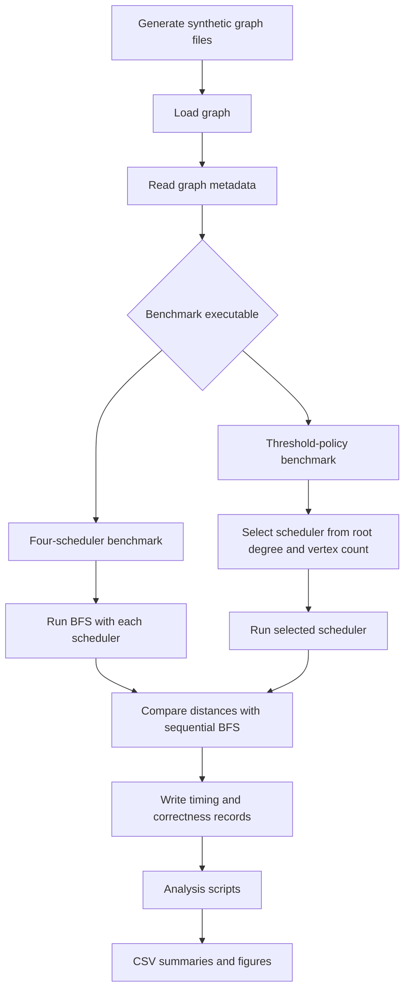

# Architecture

## 1. System Overview

Project 29 benchmarks parallel Breadth-First Search (BFS) using multiple work-scheduling strategies. The implementation is written in C++17 and uses OpenMP for shared-memory parallelism.

The repository contains two benchmark programs:

- `src/bfs_bench.cpp`: compares the four individual scheduling strategies.
- `src/bfs_bench_family_policy.cpp`: evaluates the final graph-level threshold policy against the Guided baseline.

The final policy selects a scheduler once for each input graph, before the BFS traversal starts.

## 2. High-Level Workflow



## 3. Graph Input and Representation

Synthetic graph files are generated by `scripts/generate_graphs.py`. The experimental workloads include:

- Erdős–Rényi graphs
- Grid graphs
- R-MAT graphs

The benchmark reads an edge-list input and constructs an in-memory graph representation. BFS starts from vertex 0.

The correctness check compares the parallel BFS distance vector against a sequential BFS reference. Unreachable vertices retain distance `-1`.

## 4. BFS Execution

At each BFS level, the algorithm processes the current frontier and discovers vertices in the next frontier.

The benchmark records frontier and timing information, including per-level measurements. The benchmark also collects graph/frontier characteristics used by the analysis scripts.

### Scheduling implementations

| Scheduler | Work distribution |
|---|---|
| Static | OpenMP static scheduling |
| Dynamic | OpenMP dynamic scheduling, chunk size 1 |
| Guided | OpenMP guided scheduling, chunk size 1 |
| Edge-Balanced | Assigns whole frontier vertices to thread partitions using cumulative degree estimates |

The Edge-Balanced scheduler estimates work from vertex degrees and partitions the frontier accordingly. It does not split a single high-degree vertex among multiple threads. Candidate discoveries are stored per thread, then deduplicated and applied to the distance/frontier state in a serial phase.

## 5. Graph-Level Threshold Policy

The policy implementation is in `src/bfs_bench_family_policy.cpp`.

Before BFS begins, it reads:
- `root_degree`: degree of the source vertex, vertex 0.
- `n`: graph vertex count.

It applies the following decision rule:

```cpp
if (root_degree <= 3) {
    scheduler = (n == 50000) ? "static" : "guided";
} else if (root_degree <= 1594) {
    scheduler = "edge_balanced";
} else {
    scheduler = "guided";
}
```

The selected scheduler is used for the graph's BFS execution. The policy does not switch schedulers between BFS levels. It does not directly use graph-family labels or a trained machine-learning model. Dynamic scheduling is not selected by this rule.

## 6. Timing and Output Semantics

The benchmark produces summary and per-level measurements. Interpret the timing columns according to their measurement scope:

- `total_seconds` includes policy selection and BFS execution. This is the measure used for the main threshold-policy versus Guided runtime effect.
- `bfs_wall_seconds` begins after scheduler selection and includes the BFS wall-clock execution and frontier-statistics work.
- `level_seconds` is the sum of per-level timers. It excludes the separate frontier-statistics work and is used for the baseline oracle/regret analysis.

These timing scopes are not interchangeable. In particular, do not compare an effect calculated from `total_seconds` with one calculated from `level_seconds` as though they measured the same interval.

## 7. Correctness Validation

For each benchmark execution, the parallel result is checked against sequential BFS distances. The reproducibility validation also includes tests for:
- Disconnected graphs
- Duplicate edges
- Empty-edge graphs
- Long paths
- Self-loops
- Skewed-degree graphs
- Star graphs
- Invalid and truncated edge-list input
- Threshold-policy boundary conditions

The final held-out policy runs passed the sequential BFS correctness checks.

## 8. Analysis Pipeline

The scripts in `scripts/` serve distinct purposes:

| Script | Role |
|---|---|
| `generate_graphs.py` | Generates synthetic graph inputs |
| `run_suite.py` | Runs the original multi-scheduler benchmark suite |
| `analyze.py` | Performs exploratory grouped model evaluation on scheduler timing data |
| `plot_results.py` | Produces plots from benchmark results |
| `evaluate_early_policy.py` | Explores decision-tree policies using early BFS observations |
| `evaluate_graph_policy.py` | Explores graph-level prediction using root-frontier information |
| `leave_one_family_out.py` | Evaluates exploratory models while holding out one synthetic graph family |

The exploratory machine-learning scripts use retrospective timing-derived labels. They are separate from the final hand-specified threshold policy and do not establish an online scheduler that learns or switches during traversal.

## 9. Reproducibility Layout

The final reproducibility archive contains the held-out graph inputs, baseline measurements, two policy evaluation sessions, analysis outputs, scripts, figures, source code, checksums and validation records.

Large experiment outputs are intentionally excluded from ordinary Git history. They are distributed separately as a versioned GitHub Release asset.
