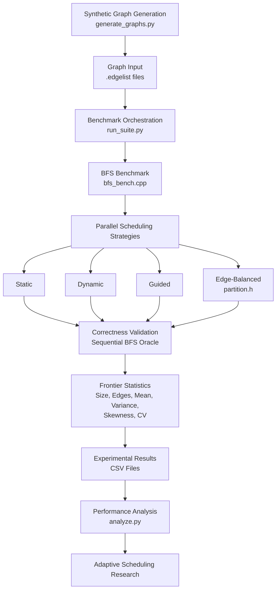

# Project Architecture

## Adaptive Scheduling for Parallel Graph Traversal

The project follows an experimental pipeline to evaluate parallel BFS scheduling strategies and investigate the potential for adaptive scheduling.

## Component Responsibilities

| Component | Responsibility |
|---|---|
| `generate_graphs.py` | Generates synthetic graph workloads |
| `run_suite.py` | Executes benchmarks across graph inputs |
| `bfs_bench.cpp` | Implements BFS and scheduling strategies |
| `partition.h` | Provides shared edge-balanced partitioning logic |
| `partition_test.cpp` | Tests partitioning correctness |
| `analyze.py` | Analyzes benchmark results |

## Scheduling Strategies

- **Static:** Assigns loop iterations using static scheduling.
- **Dynamic:** Assigns iterations dynamically to threads.
- **Guided:** Uses guided scheduling with decreasing chunk sizes.
- **Edge-Balanced:** Partitions frontier vertices using cumulative degree information.

## Research Direction

The long-term objective is to investigate whether frontier characteristics can guide scheduler selection and improve end-to-end BFS performance.

Adaptive scheduling is currently a research objective, not an implemented feature.